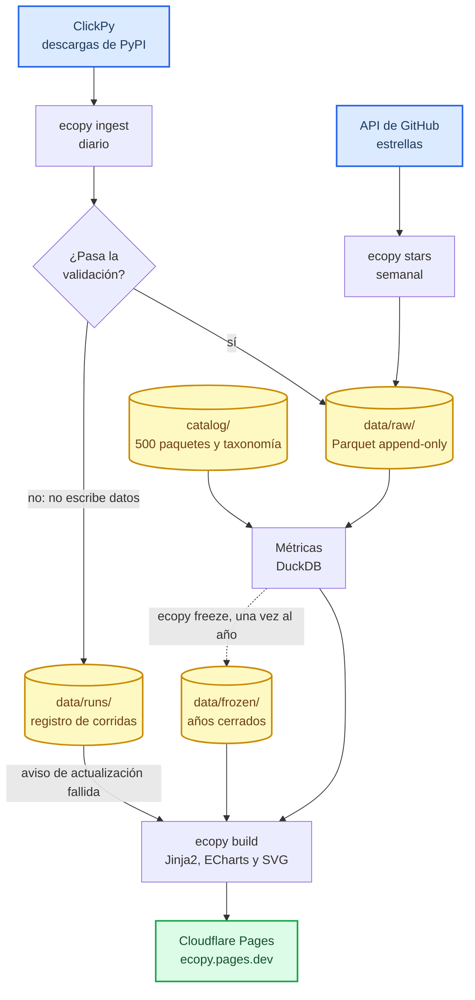
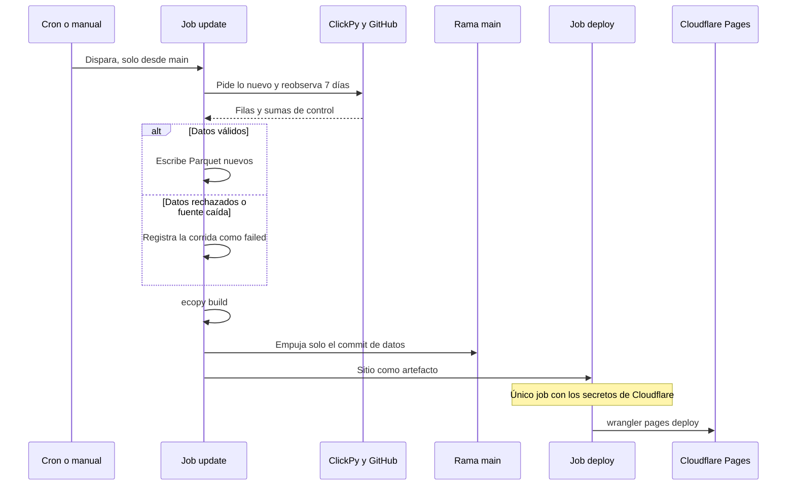
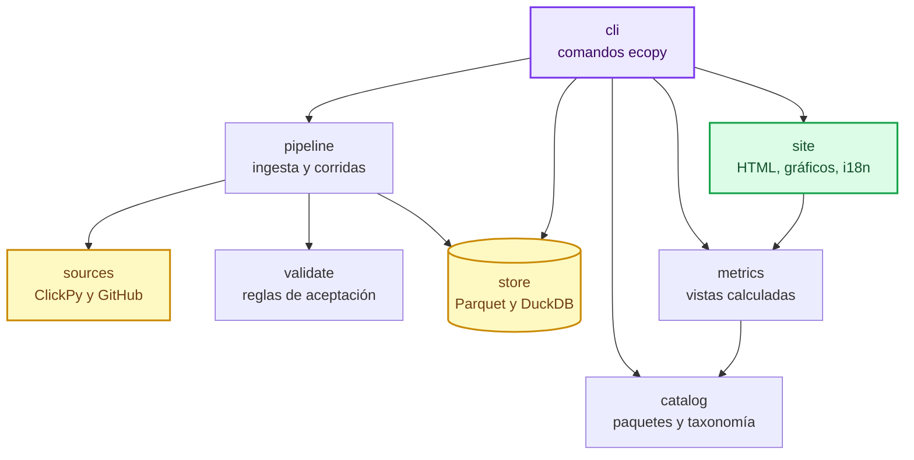
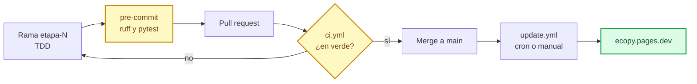

# ecopy

**The Python ecosystem, year by year.**

🌐 **[ecopy.pages.dev](https://ecopy.pages.dev)** · sitio estático, bilingüe (EN/ES), actualizado todos
los días.

## Propósito

ecopy busca dar una **mirada global y holística de todo el ecosistema Python**. Los datos existen, pero
están repartidos: las descargas se miran paquete por paquete, las estrellas repo por repo y las versiones
del lenguaje en su propio calendario. Así se ve cada pieza, pero no el conjunto.

ecopy junta esas piezas en un solo lugar y las sigue en el tiempo, desde 2017, para responder preguntas
sobre el ecosistema entero:

- ¿Qué áreas ganan peso: datos e IA, web, infraestructura?
- ¿Qué librerías crecen, cuáles pierden terreno y cuáles acaban de llegar?
- ¿A qué velocidad se adoptan las versiones nuevas de Python?
- ¿Cómo se comparan dos librerías que resuelven lo mismo?

Una métrica sola no alcanza: las descargas están infladas por CI y las estrellas no miden el uso real.
Por eso cada dimensión se muestra por separado, con su fuente y sus sesgos, y **no hay un puntaje
combinado** que las mezcle.

## Qué ofrece

- **Vista anual:** cuota de descargas por categoría, movers, recién llegados, adopción de versiones
  de Python, línea de tiempo del lenguaje y volumen total (con advertencia sobre inflación por CI).
  El año en curso se compara como YTD contra el mismo período del año anterior.
- **Fichas de librerías:** un catálogo de 500 paquetes (unión del top 100 de cada año desde 2017
  + lista curada por categoría) con su serie histórica de descargas.
- **Comparador** de hasta 4 librerías, enlazable y sin servidor.
- **Releases de Python** en una línea de tiempo.
- **Metodología:** fuentes, fórmulas, sesgos conocidos y versión metodológica de cada ranking.
- **Estrellas de GitHub** por librería, con su evolución semanal.
- **Categorías** en dos niveles (Data & AI, Development, Infrastructure & Operations, Multimedia &
  Specialized, Utilities → subcategorías como ML, desarrollo web o scraping), con página propia, y
  tags para filtrar por característica.

Principios: los rankings de años cerrados se congelan, los renombres de paquetes se enlazan pero no se
suman, y cada dato guarda su procedencia.

## Cómo funciona

No hay servidor en runtime y el costo es cero: los datos cambian una vez al día y todo es de lectura, así
que alcanza con un sitio pre-generado. El repositorio es también la base de datos: los Parquet viven en
`data/` y cada actualización es un commit.

### Flujo de datos

Los datos entran por `ingest` y `stars`, se validan antes de escribirse y nunca se sobrescriben: una
corrección de la fuente es un archivo nuevo. Las métricas se recalculan en cada build, salvo los años
cerrados, que se leen de lo congelado.



### Actualización diaria

[`update.yml`](.github/workflows/update.yml) corre todos los días a las 05:23 UTC y, los lunes a las
06:53 UTC, suma las estrellas. Si la ingesta falla, el sitio se publica igual con los últimos datos
buenos y un aviso de "Actualización fallida", y la ejecución queda marcada en rojo.



### Módulos

El código está separado por responsabilidad. `cli` coordina, `pipeline` trae y valida, y `site` solo
recibe vistas ya calculadas: **nunca toca el store**. `models` (tipos) y `quality` (discontinuidades de
las fuentes) son compartidos y no se dibujan para no cargar el diagrama.



### Del cambio a producción

Cada etapa se trabaja en su rama y entra a `main` por PR, con `ci.yml` como control. Mergear **no
despliega**: el código nuevo sale en la próxima corrida de `update`, o antes si se la dispara a mano.



## Tecnologías

| Capa | Tecnología | Para qué |
|---|---|---|
| Lenguaje y entorno | Python 3.12, [uv](https://docs.astral.sh/uv/) | Todo el pipeline y el generador; dependencias fijadas en `uv.lock` |
| Fuentes | [ClickPy](https://clickpy.clickhouse.com/) (ClickHouse), API de GitHub, [httpx](https://www.python-httpx.org/) | Descargas de PyPI y estrellas, con reintentos y límites |
| Almacenamiento | [Parquet](https://parquet.apache.org/) con [PyArrow](https://arrow.apache.org/docs/python/), [DuckDB](https://duckdb.org/) | Archivos append-only versionados en Git y consultas sobre ellos |
| Catálogo | YAML, [PyYAML](https://pyyaml.org/) | Paquetes, taxonomía, repos y releases de Python, revisables a mano |
| Sitio | [Jinja2](https://jinja.palletsprojects.com/), CSS y JavaScript propios | HTML pre-generado en EN/ES, tema claro y oscuro, CSP estricta sin inline |
| Gráficos | [Apache ECharts](https://echarts.apache.org/) 6, [Pydantic](https://docs.pydantic.dev/), SVG generado en Python | Opciones de gráficos validadas; sparklines sin JavaScript |
| Automatización | [GitHub Actions](https://docs.github.com/actions) | Actualización diaria, estrellas semanales y CI; actions fijadas por SHA |
| Hosting | [Cloudflare Pages](https://pages.cloudflare.com/), Wrangler | CDN sin servidor, con cabeceras de seguridad en `_headers` |
| Calidad | [pytest](https://docs.pytest.org/), [Hypothesis](https://hypothesis.readthedocs.io/), [Ruff](https://docs.astral.sh/ruff/), [pre-commit](https://pre-commit.com/) | Tests de contrato, propiedades y snapshots; lint y formato |

## Roadmap

Detalle y estado en [`docs/ROADMAP.md`](docs/ROADMAP.md). Cada etapa se trabaja en su propia rama.

- **Etapa 0 — Spikes de validación** ✅: cobertura de ClickPy, versiones de Python,
  histórico de estrellas, ECharts vs Plotly, tamaño de los datos.
- **Etapa 1 — Tracer bullet** ✅: un paquete, de ClickPy a una página generada en local.
- **Etapa 2 — Datos completos** ✅: backfill, catálogo y categorías, ingesta y validación.
- **Etapa 3 — Vista anual** ✅: cuotas, movers, versiones de Python y años congelados.
- **Etapa 4 — Base visual, librerías y comparador** ✅: interfaz y navegación, fichas, comparador,
  releases y estrellas. Incluye selector de tema claro y oscuro.
- **Etapa 5 — Publicación del MVP** ✅: EN/ES, metodología, seguridad, accesibilidad y despliegue
  (GitHub Actions + Cloudflare Pages).
- **Después del MVP:** Trending y Seguridad; cuentas y encuestas.

## Fuentes de datos

- Descargas de PyPI (linehaul), consultadas vía [ClickPy](https://clickpy.clickhouse.com/).
- Estrellas de GitHub: solo conteos, nunca identidades de usuarios.
- Releases de Python: lista revisada en `catalog/python_releases.yaml`.
- El dataset público de PyPI en BigQuery queda como respaldo posible; hoy no se usa.

## Desarrollo

Requiere [uv](https://docs.astral.sh/uv/) y Python ≥ 3.12.

```bash
uv sync                 # entorno + dependencias de desarrollo
uv run pre-commit install   # una vez: ruff + pytest antes de cada commit
uv run pytest           # tests
uv run ruff check . && uv run ruff format --check src tests
```

Para generar una ficha en local, con datos reales de ClickPy:

```bash
uv run ecopy ingest --project fastapi   # primera vez: histórico; después: solo lo nuevo
uv run ecopy build --project fastapi    # genera build/site/
uv run ecopy serve                      # http://127.0.0.1:8000/en/library/fastapi/ con la CSP real
```

Para generar el sitio completo, con el catálogo entero y las páginas por año:

```bash
uv run ecopy ingest   # primera vez: histórico; después: hasta ayer (UTC)
uv run ecopy freeze   # congela los años cerrados que falten; lo ya congelado no se reescribe
uv run ecopy stars    # historia de estrellas; pide GITHUB_TOKEN y se reanuda sola
uv run ecopy build    # genera build/site/; falla si falta congelar algún año cerrado
uv run ecopy serve    # http://127.0.0.1:8000/en/ con la CSP real
```

La historia completa de estrellas ya está en `data/`. Partirla desde cero lleva unas 10.000 consultas
a GitHub, en tandas de `--budget 4000` de 1 h 30 cada una.

## Documentación

- [`docs/prd.md`](docs/prd.md) — requisitos del producto, historias de usuario y decisiones.
- [`docs/ROADMAP.md`](docs/ROADMAP.md) — etapas y estado.
- [`docs/spikes/`](docs/spikes/) — informes y scripts reproducibles de la Etapa 0.
- [`docs/HANDOFF.md`](docs/HANDOFF.md) — estado actual, decisiones clave y próximos pasos.

## Licencia

[MIT](LICENSE). Los datos mostrados pertenecen a sus fuentes (PyPI/linehaul, ClickPy, GitHub) y se
publican con atribución. El sitio incluye [Apache ECharts](https://echarts.apache.org/)
(Apache-2.0; licencia y aviso en `src/ecopy/site/static/vendor/`).
