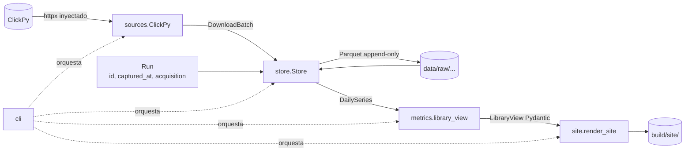

# Diseño — Etapa 1: tracer bullet (local)

> Fecha: 2026-11-07 · Estado: **aprobado por el usuario (2026-11-09)**; decisiones 1–3 volcadas al PRD · Rama
> `etapa-1-tracer-bullet`. Fuente funcional: `docs/prd.md` (Módulos, Datos, Fuentes, Testing
> Decisions). Vocabulario: módulo, interfaz, seam, adaptador, profundidad (skill `codebase-design`).

## Objetivo

Un paquete (`fastapi`), de ClickPy a una página HTML generada en `build/site/` y servida en
localhost con la CSP real, atravesando `sources → store → metrics → site → cli`. Todo en local;
sin GitHub Actions ni Cloudflare (Etapa 5).

**Fuera de la Etapa 1:** `catalog` (un solo paquete, llega por flag), `validate` y "Actualización
fallida", versiones de Python, estrellas, flags de calidad del dato, vista anual. Cada uno entra
en su etapa sin cambiar las interfaces de abajo.

## Flujo



`site` nunca toca `store` (PRD). `cli` es la única raíz de composición: crea el cliente HTTP, el
`Store` y el `Run`; ningún otro módulo instancia dependencias.

## Módulos e interfaces

### `sources.clickpy` — adaptador de ClickPy

```python
class ClickPy:
    def __init__(self, client: httpx.Client) -> None: ...
    def daily_downloads(self, projects: Sequence[str], start: date, end: date) -> DownloadBatch: ...

@dataclass(frozen=True)
class DownloadBatch:
    source: Literal["clickpy"]
    rows: tuple[DailyDownload, ...]     # (project, date, downloads), un registro por (project, date)

class SourceError(Exception): ...       # base
class TruncatedResult(SourceError): ... # lectura o resultado parcial según el resumen
class ChecksumMismatch(SourceError): ...# la descarga no cuadra con las sumas de control
class SourceUnavailable(SourceError): ...# HTTP ≥ 400, timeout
```

**Lo que esconde (profundidad):** todo lo aprendido en S1/S2/S5 — SQL, `wait_end_of_query=1`,
`GROUP BY project, date` + `sum(count)` (duplicados sin fusionar del SummingMergeTree), modo
array en lotes de ≤ 50 paquetes, sumas de control por lote, el control de truncado (filas
leídas, 1.000 filas, 10 MB), `split("\n")` del cuerpo y los reintentos con espera. El llamador
pide un rango y recibe registros completos y verificados, **o una excepción: nunca un resultado
parcial**.

**Invariantes:** `start ≤ end`; un registro por (project, date); paquetes sin descargas no
aparecen (no se inventan ceros). No conoce `acquisition` ni la política "hasta ayer": eso es del
`cli`.

**Seam y test (dependencia externa → mock):** el `httpx.Client` inyectado. Tests de contrato con
`httpx.MockTransport` sirviendo respuestas grabadas de ClickPy (cuerpo + encabezado
`X-ClickHouse-Summary`). Casos: mapeo correcto; resumen con `read_rows < total` →
`TruncatedResult`; 1.000 filas → `TruncatedResult`; suma que no cuadra → `ChecksumMismatch`;
500/timeout → `SourceUnavailable` tras reintentos. Sin red real en tests.

> Un solo adaptador de producción (ClickPy) + el de test: seam real. BigQuery (respaldo) sería el
> segundo adaptador de producción; no se diseña ahora.

### `store` — Parquet append-only

```python
@dataclass(frozen=True)
class Run:
    id: str                      # p. ej. "20261107T030000Z-observed"
    captured_at: datetime        # UTC
    acquisition: Literal["backfill", "observed"]

class Store:
    def __init__(self, root: Path) -> None: ...
    def append(self, batch: DownloadBatch, run: Run) -> list[Path]: ...
    def daily_downloads(self, projects: Sequence[str]) -> dict[str, DailySeries]: ...

DailySeries = Mapping[date, int]     # ordenada por fecha
class ImmutabilityError(Exception): ...
```

**Lo que esconde:** disposición en disco, esquema Parquet (zstd), sellado de procedencia,
DuckDB, y la resolución de correcciones.

- **Disposición única** (ajuste de S5): `root/raw/clickpy/downloads_daily/year=YYYY/<run.id>.parquet`.
  Una corrida escribe un archivo por año que toca: el backfill deja 11 archivos; la ingesta
  diaria, uno chico en el año en curso. Mismo conteo de archivos que "uno por día" (S5), pero una
  sola clave de partición para leer.
- **Procedencia sellada por el store** desde el `Run`, no por `sources`: un archivo = una corrida
  = procedencia constante (lo que hizo que costara casi nada en S5) y es imposible mezclar
  procedencias dentro de un archivo.
- **Inmutabilidad:** si el archivo destino existe → `ImmutabilityError`; nunca abre en modo
  escritura un archivo existente. Escritura atómica (archivo temporal + `rename`).
- **Correcciones:** al leer, por cada (project, date) gana el registro de mayor `captured_at`.

**Seam y test (local sustituible):** un `tmp_path` real; sin mocks. Casos: `append` + leer
devuelve lo escrito; dos `append` con distinto `Run` no modifican archivos previos (hash de
bytes antes/después); mismo `Run.id` dos veces → `ImmutabilityError`; una corrección posterior
gana al leer; store vacío → `{}`.

### `metrics` — funciones puras

```python
def library_view(project: str, series: DailySeries, *, as_of: date) -> LibraryView: ...
```

`LibraryView` (Pydantic, congelado) lleva lo que la ficha necesita y nada de cómo calcularlo:
serie mensual (meses completos + mes en curso marcado parcial), total por año con 2016 marcado
parcial y el año en curso como YTD, último mes cerrado, primera fecha con datos.

**Seam y test (en proceso):** la firma misma. Unitarios + propiedades con Hypothesis: la suma
mensual = la suma diaria; los meses salen contiguos y ordenados; nada posterior a `as_of`
aparece; 2016 siempre `partial=True`. Es el módulo que más crece (Etapa 3), por eso nace puro.

### `site` — render estático

```python
def render_site(pages: Sequence[LibraryView], out: Path, *, langs=("en", "es")) -> None: ...
```

**Lo que esconde:** Jinja2 con autoescape, plantillas, textos EN/ES, serialización de las
opciones de ECharts desde Pydantic a `<script type="application/json">`, el JS de arranque
(archivo propio, sin inline), la copia de ECharts 6 `common` y el `_headers` con la CSP del PRD.

- **ECharts vendorizado** en `src/ecopy/site/static/vendor/echarts-6.1.0.common.min.js` con su
  SHA-256 fijo en el código; `render_site` falla si el hash no coincide (S4: servido desde
  `'self'`, versión fija verificada). Sin red al construir.
- Salida: `out/{en,es}/library/<project>/index.html`, `out/static/…`, `out/_headers`.

**Seam y test:** `LibraryView` fijos → HTML comparado con snapshots; un `project` con
`<script>` sale escapado; `_headers` contiene la CSP; ningún `<script>` ni `style=` inline.

### `cli` — raíz de composición

```text
ecopy ingest --project fastapi [--since 2016-01-22] [--data data/]   # backfill o incremental
ecopy build  --project fastapi [--data data/] [--out build/site/]
ecopy serve  [--out build/site/] [--port 8000]                      # aplica _headers (CSP)
```

```python
def main(argv: Sequence[str] | None = None, *, http: httpx.Client | None = None,
         now: Callable[[], datetime] = utcnow) -> int: ...
```

Política que vive acá (pura y testeada aparte): la ventana termina **ayer UTC** (S1); sin datos
previos → `acquisition="backfill"` desde `--since`; con datos → `observed` desde el último día
guardado + 1. `serve` es un `http.server` que lee `_headers`, para probar la CSP real en local
(lo que hizo S4 a mano).

**Seam y test (humo end-to-end):** `main([...], http=Client(transport=MockTransport(fixtures)),
now=fijo)` sobre `tmp_path` → existen `en/` y `es/` de la ficha con las cifras esperadas y el
`_headers` con la CSP. Es el test que prueba que el tracer bullet atraviesa todo.

## Estructura del proyecto

```text
pyproject.toml            # uv, Python ≥ 3.12; deps: httpx, pyarrow, duckdb, jinja2, pydantic
src/ecopy/
  sources/clickpy.py
  store.py
  metrics.py
  models.py               # DailyDownload, DownloadBatch, Run, LibraryView (tipos compartidos)
  site/{render.py, templates/, static/}
  cli.py
tests/
  fixtures/clickpy/       # respuestas grabadas (cuerpo + resumen), generadas por un script
  test_sources_clickpy.py  test_store.py  test_metrics.py  test_site.py  test_cli.py
```

Dev: `pytest`, `hypothesis`, `ruff`, `pre-commit`. CLI con `argparse` (stdlib; tres comandos no
justifican Typer/Click).

## Decisiones (aprobadas 2026-11-09)

1. **`normalized` como vista, no como capa física (en esta etapa).** El PRD dice `raw →
   normalized`. Con una sola fuente, "normalizar" es deduplicar y resolver correcciones, que el
   `store` hace al leer. Materializarla duplicaría los datos (el ×2 de S5) sin comportamiento
   nuevo — prueba de borrado: si se quita, no reaparece complejidad en ningún llamador. Se
   materializa cuando haya una segunda fuente que mapear (BigQuery) o cuando la lectura sea
   lenta. Aprobado: vista.
2. **Procedencia sellada por `store`, no por `sources`.** El PRD dice que `sources` devuelve
   "registros tipados con procedencia". Propongo que devuelva `source` por lote y que el `Run`
   (que crea el `cli`) le dé al `store` `acquisition`, `captured_at` e `ingestion_run_id`.
   Evidencia: en S5 la procedencia constante por archivo costó ~0 bytes; y `sources` no tiene
   cómo saber si una corrida es backfill u observada.
3. **`data/` versionado desde ya** (como dice el PRD) aunque sea un solo paquete: ~100 KB.
   Aprobado: se versiona.

## Slices de la Etapa 1 (TDD, en orden)

1. **Esqueleto:** `pyproject.toml` con uv, `src/ecopy/`, `ruff` + `pytest` + `hypothesis`
   configurados; un test trivial en verde.
2. **`sources.clickpy`:** script que graba fixtures reales de `fastapi` (rango corto) + tests de
   contrato con `MockTransport` (incluye truncado y cuadre).
3. **`store`:** append + lectura + inmutabilidad + corrección sobre `tmp_path`.
4. **`metrics.library_view`:** unitarios + propiedades.
5. **`site.render_site`:** plantillas, ECharts vendorizado con hash, `_headers`, snapshots y
   escape.
6. **`cli`:** `ingest`, `build`, `serve` + test de humo end-to-end; corrida real con `fastapi`
   desde 2016 y verificación en Chrome headless sin violaciones de CSP.
