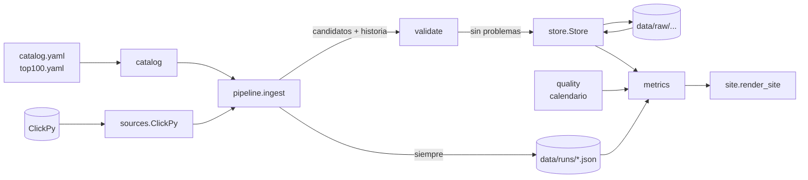

# Diseño — Etapa 2: datos completos

> Fecha: 2026-11-09 · Estado: **aprobado por el usuario (2026-11-09)**, las 10 recomendaciones; decisión 4 sin marcar agosto de 2026, decisión 8 con la categoría 39 · Rama
> `etapa-2-datos-completos`. Fuente funcional: `docs/prd.md`. Interfaces previas:
> `docs/design/etapa-1-tracer-bullet.md`. Vocabulario: módulo, interfaz, seam, adaptador,
> profundidad (skill `codebase-design`).

## Objetivo

Pasar del tracer bullet de un paquete al dataset real, en local: catálogo de ~500 paquetes,
backfill desde 2016-01-22, ingesta incremental, adopción de versiones de Python, denominador
total de PyPI, validación con "Actualización fallida" y calidad del dato.

**Fuera de la Etapa 2:** vista anual y cálculo de cuotas (Etapa 3), estrellas de GitHub y
releases de Python (Etapa 4; S5 suponía el backfill de estrellas acá, pero el ROADMAP lo ubica
en la 4 y son ~9.000 consultas), BigQuery de respaldo, Actions y Cloudflare (Etapa 5).

## Evidencia medida para este diseño (2026-11-09, ~15:40 UTC)

Solo lectura contra ClickPy, con el adaptador real. Línea de base: los Parquet de S5.

| Pregunta | Resultado |
|---|---|
| ¿ClickPy corrige días cerrados? | **0 de 1.656.388 filas cambiaron** (500 paquetes, 2016-01-22 → 2026-11-06) entre la captura de S5 (2026-11-07 23:14 UTC) y hoy, ~40 h después. Ninguna fila desapareció. |
| ¿Y con una ventana algo mayor? | Los totales anuales 2016–2025 coinciden con los de S1 (2026-11-06), en millones. |
| ¿El último día está incompleto? | 2026-11-06, el día que S1 marcó "posiblemente incompleto", sigue en 5.873 M. Era viernes: el viernes anterior dio 5.633 M. No hay evidencia de que estuviera incompleto. |
| ¿Hasta qué día hay datos? | A las 15:40 UTC, hasta ayer (2026-11-08) en ambas tablas; el día en curso no aparece. |
| ¿Versiones cuadra con el total? | Igual en 125 de 130 meses. Difiere en 2026-04 (+114 M), 06, 07, 08 y 10 (−4,9 M): ~0,08 % como máximo, estimado con el promedio mensual de 2026. **Son meses cerrados**, así que la carga en vivo con la que S2 lo explicó no alcanza. |
| Costo del denominador | 1 consulta en modo array, 0,7 s, 131 KB, 3.866 días. Cuadra con la suma de control. |
| Costo de versiones (global, mensual) | 4 rangos + 4 controles, ~23 s, 10.644 M de filas leídas por pasada, 8.896 filas sumadas, 85 valores distintos de `python_minor`. Cuadra por rango. |
| Dispersión diaria (día / mediana de los 4 mismos días de semana previos) | Desde 2020 (2.504 días): mínimo 0,529 (2020-01-01), máximo 1,494. Ningún día bajo 0,5 ni sobre 2. |
| ¿Hay huecos propios de un paquete? | Sí, contra lo que sugería S1 con 5 paquetes: 369 de 500 tienen días sin filas dentro de su historia (2.834 días; `uv` 521). Desde 2025 solo 2 paquetes, ambos nuevos. Un día sin filas de un paquete **no es un hueco de la fuente**. |
| Lectura con 10 años de archivos diarios | 3.651 archivos, 3,48 M de filas: `Store.daily_downloads` de 500 paquetes tarda 3,6 s; el último día por paquete, 0,16 s. **No hace falta compactar** (cierra el abierto de S5). |

**Límites de la medición:** cubre una ventana de ~40 h y un solo par de capturas. No dice nada
de reprocesos raros a más largo plazo, ni de qué pasa en las primeras horas después de cerrar
un día. Por eso la decisión 1 no asume que no hay correcciones: las sigue midiendo.

**Hallazgo sin resolver:** desde 2026-08-25 el total de PyPI cae ~36 % de un día para el otro
(6.283 M diarios del 10 al 23 de agosto, 4.002 M del 25 de agosto al 7 de septiembre) y se recupera
despacio: 4.921 M a mediados de octubre, ~0,92 del nivel previo en noviembre. La cuota del catálogo
casi no se mueve (67,0 % → 67,7 %), pero algunos paquetes sí: `weaviate-client` ×0,12, `litellm` y
`textual` ×0,16. No es un hueco ni cumple la regla de degradados; no se investigó la causa, y
importa para el volumen absoluto de la Etapa 3, igual que el salto de 2018-07-27.

## Flujo



`site` sigue sin tocar `store`. `cli` queda como parser y raíz de composición.

## Módulos e interfaces

### `sources.clickpy` — tres consultas nuevas

```python
class ClickPy:
    def daily_downloads(self, projects, start, end) -> DownloadBatch: ...          # existente
    def pypi_daily_totals(self, start: date, end: date) -> PypiTotalsBatch: ...
    def python_minor_monthly(self, through: date) -> PythonMinorBatch: ...
    def top_projects(self, years: Sequence[int], n: int = 100) -> Mapping[int, tuple[str, ...]]: ...
```

**Lo que esconde, además de lo de la Etapa 1:** los 4 rangos de `project` de la tabla de 10.600 M
de filas (el filtro por fecha no reduce lo leído), los separadores de control de `python_minor`
y los años de a 5 en `top_projects` para no llegar a 1.000 filas. `python_minor_monthly` devuelve
solo meses cerrados a `through` y guarda `python_minor` **crudo**, basura incluida: filtrar contra
las versiones reales es de `metrics`, en la Etapa 3, cuando exista la fuente de releases.

**Invariante que se mantiene:** datos completos y cuadrados contra el servidor, o una excepción.

**Seam y test:** `httpx.MockTransport` con fixtures grabadas por etiqueta (`/* ecopy:<tag> */`).
Casos: mapeo, truncado, suma que no cuadra, basura con comas y barras, y límites de meses cerrados.

### `store` — varios datasets y escritura de cambios

```python
class Store:
    def append(self, batch: Batch, run: Run) -> AppendResult: ...     # (paths, new_rows, revised_rows)
    def daily_downloads(self, projects) -> dict[str, DailySeries]: ...
    def pypi_daily_totals(self) -> DailySeries: ...
    def python_minor_monthly(self) -> Mapping[date, Mapping[str, int]]: ...
    def last_days(self) -> Mapping[str, date]: ...                    # por paquete, sin cargar series
```

**Lo que esconde:** el esquema y la clave de cada dataset, la partición por año y la resolución
de correcciones. `Batch` es la unión de los tres tipos; agregar un dataset es agregar una fila a
una tabla privada, sin métodos nuevos de escritura.

**Cambio de comportamiento:** `append` escribe **solo las filas nuevas o que cambiaron** respecto
de la versión vigente, y devuelve cuántas de cada una. Sin cambios no hay archivo. Un `Run.id`
repetido sigue fallando con `ImmutabilityError`, aunque no haya nada que escribir.

**No cubierto:** si la fuente borra una fila, el store conserva el último valor. No se observó
ningún caso; agregar borrados lógicos no se justifica sin evidencia.

**Seam y test:** `tmp_path` real, sin mocks. Se suman: reobservar sin cambios no escribe; un valor
distinto escribe solo esa fila y gana al leer; los datasets no se mezclan; `last_days`.

### `quality` — calendario de la fuente (nuevo, puro)

```python
class DayQuality(StrEnum): OK = "ok"; GAP = "gap"; DEGRADED = "degraded"
def day_quality(day: date) -> DayQuality: ...
def period_coverage(first: date, last: date) -> Coverage: ...   # días esperados, con hueco, degradados
```

Los períodos conocidos son una constante documentada, con su evidencia al lado (decisión 3).

**Seam y test:** la firma. Bordes de cada ventana y propiedad: esperados = ok + hueco + degradados.

### `metrics` — estado de cada período

`MonthPoint` y `YearTotal` reemplazan sus booleanos por un estado único y explícito, que es lo
que arregla el "Completo" falso:

```python
PeriodStatus = Literal["complete", "in_progress", "package_start", "source_gap", "degraded"]
```

Precedencia, de más a menos urgente: `in_progress` > `package_start` > `source_gap` > `degraded` >
`complete`. Además llevan `coverage: Coverage` para que la ficha pueda decir "363 de 365 días".

| Período | Hoy | Con este diseño |
|---|---|---|
| 2018 de `fastapi` (desde el 8-dic) | Completo | Desde el primer release |
| 2016 | Datos parciales | Con huecos (empieza el 22-ene, faltan 77 días) |
| 2018 de un paquete viejo | Completo | Degradado |
| 2019 | Completo | Con huecos (2 días) |
| 2016-01, primer mes de un paquete | Completo | Con huecos / Desde el primer release |
| Días sin filas de un paquete en un mes normal | Completo | Completo: es cero descargas, no un hueco |

**Seam y test:** `library_view(...)`, con unitarios y propiedades con Hypothesis. El estado solo
depende del calendario, de la primera fecha del paquete y de `as_of`.

### `validate` — reglas puras (nuevo)

```python
@dataclass(frozen=True)
class Problem: code: str; dataset: str; detail: str

def check(candidate: Candidates, history: History, *, catalog, as_of: date) -> list[Problem]: ...
```

Reglas, con los umbrales de la decisión 5: volumen del día contra los mismos días de semana
previos, presencia de los paquetes del catálogo que tenían datos recientes, ningún paquete por
encima del total del día, versiones contra total por mes, y datos no más viejos que 3 días.

**Seam y test:** la firma, sin E/S. Un caso por regla, con el borde justo a cada lado del umbral.

### `pipeline` — orquestación de la ingesta (nuevo)

```python
def ingest(catalog: Catalog, source: ClickPy, store: Store, *, now: datetime,
           reobserve_days: int = 7) -> RunReport: ...
```

**Lo que esconde:** a qué ventana va cada paquete (sin datos → backfill; con datos → desde el
último día del dataset menos `reobserve_days`), cuándo toca traer versiones (solo si falta un mes
cerrado), la validación previa a escribir, y el registro de la corrida.

La ventana se ancla al **último día guardado del dataset**, no a hoy ni al último día de cada
paquete: un paquete sin descargas desde 2020 no arrastra la consulta de todos, y una caída de
varios días se recupera sola.

El registro es `data/runs/<id>.json`, uno por ejecución, append-only: estado, problemas, filas
nuevas y corregidas por dataset, último día. Sirve para el aviso, para la fecha de última
actualización (historia 24) y para **seguir midiendo correcciones en cada corrida**.

**Seam y test:** `ClickPy` real sobre `MockTransport` + `Store` en `tmp_path`, sin mocks propios.
Casos: paquete nuevo y paquete existente en la misma corrida; reobservación; un candidato inválido
no escribe datos y sí registra el fallo; una `SourceError` también registra el fallo.

### `catalog` (nuevo)

```python
@dataclass(frozen=True)
class Library: project: str; category: str; tags: tuple[str, ...]; repo: str | None; renamed_from: str | None

class Catalog:
    @classmethod
    def load(cls, root: Path) -> Catalog: ...     # valida y falla con todos los errores juntos
    projects: tuple[str, ...]
    def library(self, project: str) -> Library: ...
    def domain_of(self, category: str) -> str: ...
```

Datos en `catalog/` (fuera de `src/`): `taxonomy.yaml` (dominios, categorías y tags, con slug y
etiquetas EN/ES), `libraries.yaml` (curado) y `top100.yaml` (generado, decisión 6).

**Validaciones al cargar:** exactamente una categoría existente por librería, tags del vocabulario,
sin duplicados, renombres que apuntan a un paquete del catálogo, y todo el top 100 categorizado.
La existencia real se comprueba contra ClickPy en `ecopy catalog check`: necesita red y no va en
la carga. **Seam y test:** YAML de ejemplo en `tmp_path`; un caso por validación.

### `cli` y `site`

```text
ecopy ingest   [--project X ...] [--reobserve-days 7] [--data data/]
ecopy validate [--data data/]                     # mismas reglas sobre los últimos días guardados
ecopy build    [--project X ...] [--data data/] [--out build/site/]
ecopy serve    [--out build/site/] [--port 8000]
ecopy catalog  refresh | check
```

Sin `--project` se usa todo el catálogo. `--reobserve-days 4000` hace una auditoría completa por
~20 consultas, sin comando aparte. `render_site` recibe además un `SiteStatus` (última
actualización y si la última corrida falló) y muestra el aviso en EN/ES.

**Seam y test:** humo end-to-end con `main([...], http=MockTransport, now=fijo)`, incluido el caso
de corrida rechazada → sitio con aviso y cifras del día anterior. Snapshots de `site` actualizados.

## Decisiones para que revises

Las marcadas **cambia el PRD** requieren actualizarlo si las aceptás.

1. **Reobservar los últimos 7 días en cada corrida y escribir solo lo que cambió.**
   *Recomendado.* Hoy no hay correcciones que captar (0 de 1,66 M), pero la medición cubre solo
   40 h. Sin costo extra: el filtro por fecha no reduce lo leído, y sin cambios no se escribe
   nada. Cada corrida deja contadas las correcciones, así que la pregunta se contesta sola con el
   tiempo. Alternativa: no reobservar; ahorra casi nada y deja el riesgo a ciegas.
2. **Validar antes de escribir, y "Actualización fallida" reconstruyendo con aviso.** *Recomendado,
   cambia el PRD.* El PRD dice publicar el build anterior. Pero una corrida mala escrita ganaría
   al leer, porque la corrección más reciente manda, y habría que armar una cuarentena. Si no
   entra al store, reconstruir da las mismas cifras de ayer más el aviso, sin guardar builds.
3. **Calidad como calendario en código, no como flag en el store.** *Recomendado, cambia el PRD.*
   Un hueco no tiene filas donde poner un flag: faltan 78 días enteros. Además los períodos son
   globales, y un flag físico obligaría a reescribir o duplicar datos inmutables al afinarlos.
4. **Contenido del calendario.** *Recomiendo ampliar lo de S1,* usando la misma regla (día bajo
   0,5 de lo normal, todos anteriores a 2020):
   - Huecos: 2016-03-06→05-21 (el 03-06 tiene 5 descargas en total) y 2019-04-26/27.
   - Degradados: 2018-07-**11**→26 (S1 decía desde el 13, pero el 11 da 0,31 y el 12 da 0,41), más
     2016-12-08, 2017-05-11, 2018-04-17, 2019-04-13, 2019-04-25 y 2019-04-28.
   - La caída desde 2026-08-25 queda **sin marcar** (decidido): no cumple la regla.
5. **Umbrales de `validate`.** *Recomendado:* rechazar un día bajo 0,4 o sobre 2,0 de lo normal
   (desde 2020 nunca pasó; 0,5 dejaría muy poco margen sobre el 0,529 de Año Nuevo), menos de 98 %
   de los paquetes esperados, versiones contra total con más de 0,5 % de diferencia (hoy, ~0,08 %)
   y datos con más de 3 días de atraso. Un falso positivo congela el sitio un día; uno negativo
   deja un día malo hasta que se corrija, y la reobservación lo cubre.
6. **Top 100 como archivo generado y revisado, no calculado en cada corrida.** *Recomendado.* El
   PRD dice "calcula la unión". Si se calcula en vivo, el top del año en curso cambia solo y un
   paquete sin categoría rompería la ingesta. `ecopy catalog refresh` genera `top100.yaml`: los
   años cerrados quedan fijos y lo que entra se ve en el diff.
7. **Armado de las ~290 librerías curadas.** La unión da 213 (S5). *Recomiendo* que yo redacte el
   borrador de `libraries.yaml` con categoría y tags para las ~500, a partir de `categorias.md` y
   del ranking de 2025 equilibrado por categoría, y que vos revises por excepción. Necesito saber
   si lo querés así o preferís armar la lista vos.
8. **Taxonomía.** Las 38 categorías del PRD salen de la propuesta de la sección 3 de
   `categorias.md`, pero la tabla de la sección 1 trae además "Aplicaciones interactivas y
   dashboards" (`streamlit`, `gradio`, `dash`, `panel`), que quedó afuera. *Recomiendo* agregarla
   como categoría 39: si no, esas librerías caen en "Desarrollo web". Si la sacaste a propósito,
   se mantienen las 38.
9. **Versiones de Python: solo meses cerrados, y traer todo cuando falte uno.** *Recomendado.* Cada
   pasada lee 10.644 M de filas, y filtrar por fecha no lo reduce; hacerlo a diario es abusar de un
   servicio gratuito. Mensual da el mismo resultado para la historia 5, y como la pasada trae todo
   igual, detecta correcciones en toda la serie. El mes en curso no se muestra.
10. **Módulo `pipeline` y un solo comando `ingest`.** *Recomendado, cambia el PRD.* El PRD lista
    `ingest` y `backfill` en `cli`. La diferencia ya se decide por paquete, así que `backfill` no
    agrega nada. Y la orquestación crece lo suficiente como para sacarla del parser.

## Ajustes al implementar

- `python_minor_monthly(before=...)` recibe el corte y `pipeline.python_cutoff` decide los meses
  cerrados: la política no vive en `sources`.
- `pipeline.ingest` recibe los nombres de paquetes, no el `Catalog`, para aceptar `--project`.
- Sus tests usan una fuente en memoria que respeta los rangos pedidos: el replay no ejecuta SQL y
  no podría probar las ventanas. `MockTransport` queda para el humo end-to-end de `cli`.
- `ClickPy.known_projects` se agregó para `ecopy catalog check`.
- `Store.record_run` y `Store.runs` guardan y leen `data/runs/`.
- Los tests de versiones, totales y top 100 usan respuestas con el formato real, no grabadas. Las
  consultas se verificaron contra ClickPy real en la corrida del slice 8.

## Slices (TDD, de corrido, para el ROADMAP una vez aprobados)

1. **Calidad y estados de período:** `quality`, `metrics`, etiquetas en `site`. Sin red; arregla
   el "Completo" falso. Incluye pasar las mediciones de arriba a `docs/spikes/` con su script.
2. **Store multi-dataset:** tabla de datasets, escritura de cambios, `last_days`, sin regresiones
   en inmutabilidad.
3. **Fuentes nuevas:** totales, versiones y top 100, con fixtures grabadas.
4. **Catálogo:** `catalog`, `taxonomy.yaml`, `ecopy catalog refresh|check`.
5. **Ingesta real:** `validate`, `pipeline.ingest`, `data/runs/`, `ecopy ingest|validate`, multi
   paquete.
6. **"Actualización fallida":** `SiteStatus`, aviso EN/ES, humo end-to-end de corrida rechazada.
7. **Contenido del catálogo:** `libraries.yaml` con ~500 librerías, revisado por el usuario.
8. **Corrida real:** backfill de ~500, un incremental, build de todas las fichas; se compara
   contra S5 (~20 consultas con los controles, ≈ 10 MB) y se prueba una reobservación en un día posterior.

Los slices 1–6 no dependen del contenido final del catálogo, así que se puede revisar la lista
sin frenar el código.
