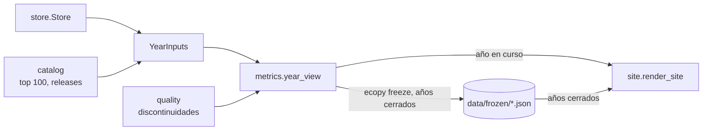

# Diseño — Etapa 3: vista anual

> Fecha: 2026-11-09 · Estado: **aprobado por el usuario (2026-11-09)**, las 6 decisiones; el congelado real espera la revisión del catálogo · Rama sugerida
> `etapa-3-vista-anual`. Fuente funcional: `docs/prd.md` (historias 1–11). Interfaces previas:
> `docs/design/etapa-2-datos-completos.md`. Vocabulario: módulo, interfaz, seam, adaptador,
> profundidad (skill `codebase-design`).

## Objetivo

Una página por año desde 2017, en EN/ES: cuota por dominio y categoría, movers, recién llegados,
adopción de versiones de Python, línea de tiempo del lenguaje y volumen total con advertencia. El
año en curso se compara contra el mismo período del anterior y los años cerrados quedan congelados
con su versión metodológica. Todo en local.

**Fuera de la Etapa 3:** páginas de dominio y categoría, fichas ampliadas, comparador, estrellas y
página de releases (Etapa 4); pulido visual, metodología y portada definitiva (Etapa 5).

## Evidencia medida (2026-11-09, sobre `data/`, datos hasta 2026-11-08)

| Pregunta | Resultado |
|---|---|
| ¿El catálogo sirve de denominador? | Representa 66,3–70,9 % de PyPI todos los años, sin deriva. "Infraestructura base" es 33,2–36,2 % del catálogo. |
| ¿Se mueven las cuotas? | Dominios en 2025: Infraestructura 57,2 %, Desarrollo 30,5 %, Datos e IA 9,1 %, Utilidades 2,2 %, Multimedia 1,1 %. Datos e IA pasa de 2,9 % (2017) a 9,2 % (2026). |
| ¿Qué domina los movers? | Entre los 40 mayores de 2019, 2024, 2025 y 2026, son "Infraestructura base" 19, 19, 14 y 11. |
| ¿Hay movers artificiales? | `cloudflare`, `acme` y `certbot-dns-cloudflare` suben +0,53–0,54 puntos en 2025 y bajan lo mismo en 2026: parecen una sola automatización. |
| ¿Cuántos recién llegados hay? | 7–19 por año entrando por primera vez al top 100 (2018–2026). Sin dependencias se lee mejor: en 2026 aparecen `fastapi`, `starlette` y `uvicorn`. |
| Versiones de Python | Coincide con S2: 2.7 = 80,6 % en 2017; 3.12 = 31,6 % en 2026. Sin versión: 3,6–11,1 %. Otra basura: ≤ 0,02 %. Hay 84 valores crudos. |
| YTD | 1.520 G en 2026 contra 737 G del mismo período de 2025 (×2,06). 2025 completo fue 901 G: comparar contra el año entero daría una lectura errónea. |
| Renombres | Solo `pycodestyle` / `pep8` llegan juntos al top 100 (2017). `docker` entra en 2019 sin que `docker-py` haya estado. |

**Límite:** la lectura de "automatización" del trío de Cloudflare es una inferencia por la igualdad
de las cifras; no se verificó la causa.

## Flujo



## Módulos e interfaces

### `catalog` — top 100 y releases

```python
class Catalog:
    def top(self, year: int) -> tuple[str, ...]: ...
    def python_releases(self) -> tuple[PythonRelease, ...]: ...   # versión, lanzamiento, fin de soporte
```

Datos nuevos en `catalog/python_releases.yaml` (decisión 5). Las etiquetas de dominios y categorías
se exponen por slug para que `site` las resuelva: renombrar una etiqueta no toca lo congelado.

**Seam y test:** YAML de ejemplo; versión duplicada y fechas invertidas se rechazan.

### `metrics.year_view` — función pura

```python
METHODOLOGY_VERSION = 1

@dataclass(frozen=True)
class YearInputs:
    downloads: Mapping[str, DailySeries]
    totals: DailySeries
    python_minor: Mapping[date, Mapping[str, int]]
    catalog: Catalog

def year_view(year: int, inputs: YearInputs, *, as_of: date) -> YearView: ...
```

`YearView` (Pydantic, congelado, serializable) lleva `year`, `status` (`closed`/`ytd`),
`methodology_version`, `period`, `coverage`, `volume`, `catalog_share`, `domains` (con categorías),
`movers_up`, `movers_down`, `newcomers`, `python_versions`, `python_unknown_share` y `timeline`.

**Lo que esconde:**
- **Ventanas:** año cerrado completo; año en curso de 1-ene a `as_of`, contra una ventana del año
  anterior con **la misma cantidad de días** (PRD, historia 8).
- **Cuotas:** sobre el total del catálogo: suman 100 % por categoría y por dominio (historia 52).
- **Movers:** diferencia en puntos de cuota y cambio de posición contra el período anterior, 10 y
  10. Sin "Infraestructura base" en la lista, aunque sí en las cuotas. Nunca hay puntaje combinado.
- **Recién llegados:** en el top 100 de ese año por primera vez desde 2017, sin "Infraestructura
  base". Un paquete renombrado no cuenta si su nombre anterior ya estuvo.
- **Renombres:** enlazan y nunca se suman.
- **Versiones:** meses cerrados del período; solo versiones de `python_releases.yaml`, "otra" y "sin
  versión" aparte, sin repartir.
- **Volumen:** total, anterior y crecimiento, que es `None` si la comparación cruza una
  discontinuidad.

`quality` suma `DISCONTINUITIES` (2018-07-27 y, según la decisión 3, 2026-08-25).

**Seam y test:** la firma. Unitarios más propiedades con Hypothesis: las cuotas suman 1; las
ventanas YTD tienen igual longitud; los renombres no se suman; 2017 no tiene movers; nada posterior
a `as_of` cambia el resultado; un año cerrado no cambia si llegan datos de años siguientes.

### `store` — años congelados

```python
class Store:
    def freeze_year(self, view: YearView) -> Path: ...              # nunca reescribe
    def frozen_year(self, year: int) -> YearView | None: ...        # la metodología más alta
```

Un archivo por año y metodología: `data/frozen/year=YYYY/methodology=N.json`. Una metodología nueva
es un archivo nuevo; el anterior se conserva.

**Seam y test:** `tmp_path`: congelar dos veces la misma versión falla; una versión mayor gana al leer.

### `site` y `cli`

```python
def render_site(pages, out, *, years: Sequence[YearView] = (), status=None, labels=...) -> None: ...
```

Rutas: `/{lang}/year/{año}/` y `/{lang}/` con la lista de años. Tres gráficos, todos con su tabla:
cuota de cada categoría, adopción de Python por año y volumen anual con las discontinuidades
marcadas. El arranque pasa a un `charts.js` genérico. Se aplica el skill `dataviz` antes de los
gráficos; el pulido queda para la Etapa 5. Los tipos de `common` alcanzan (S4): no hace falta `full`.

```text
ecopy freeze [--data data/] [--catalog catalog/]   # congela los años cerrados que falten
ecopy build  ...                                   # falla si a un año cerrado le falta congelar
```

`build` nunca escribe en `data/`. **Seam y test:** humo end-to-end y snapshots: año cerrado, año en
curso, 2017 sin movers, aviso de volumen, escape de nombres externos.

## Decisiones para que revises

Las marcadas **cambia el PRD** requieren actualizarlo si las aceptás.

1. **Cuotas sobre el total del catálogo.** *Recomendado.* Es la única forma de que sumen 100 %
   (historia 52), y el catálogo es estable: 66–71 % de PyPI cada año. La página muestra ese
   porcentaje como contexto. Alternativa: dividir por todo PyPI y agregar "resto" (~30 %), que sería
   la categoría más grande y no explicaría nada.
2. **Movers y recién llegados sin "Infraestructura base", y 2017 sin ninguno de los dos.**
   *Recomendado.* Son 11–19 de los 40 mayores movers en los cuatro años medidos, y casi nadie los instala a propósito (es la
   razón de esa categoría en el PRD). 2017 no tiene año anterior completo. El trío de Cloudflare se
   muestra igual, con nota en metodología: excluir casos a mano sería un criterio opaco.
3. **Tratar 2026-08-25 como discontinuidad, igual que 2018-07-27.** *Recomendado.* Se marca en el
   gráfico y no se calcula crecimiento de volumen que la cruce, así que 2026 y 2027 no mostrarían
   el ×2,06. Sin conocer la causa, un número grande sin advertencia es peor que ninguno, y es fácil
   de revertir. Las cuotas no se afectan: el catálogo se mantuvo en 67,0–67,7 %.
4. **Congelar toda la vista anual, con un comando explícito.** *Recomendado.* Más simple que
   congelar solo el ranking, y una sola regla: año cerrado = archivo. Corregir un error exige una
   metodología nueva, que es lo que pide la historia 10. `build` no congela porque no debe escribir
   datos. Se congelan 2017–2025 como metodología 1 al final de la etapa.
5. **Releases de Python en un YAML curado, no un adaptador.** *Recomendado, cambia el PRD.* Son ~25
   filas que cambian una vez por año, y hacen falta ya para filtrar versiones y para la línea de
   tiempo. El PRD los pone en `sources`, pero un adaptador no aporta nada con esa frecuencia. Verifico
   las fechas contra una fuente pública al escribirlo; la Etapa 4 reutiliza el archivo.
6. **Tu revisión de `catalog/libraries.yaml` tiene que ser antes de congelar.** Las categorías quedan
   fijas en la metodología 1, y cambiarlas después exige una metodología 2. No frena el código: solo
   el último slice. Necesito que me digas cuándo la diste por revisada.

## Ajustes al implementar

- **Adopción de Python:** barras de una sola serie con las versiones del año, más una tabla con la
  versión más usada de cada año. Una serie apilada de todos los años necesitaría unas 10 versiones,
  y la guía de `dataviz` admite hasta 8 colores; la serie histórica se retoma en la Etapa 5.
- `charts.js` dibuja solo los gráficos de barras; `library.js` sigue dibujando la línea de la ficha.
- Las discontinuidades se marcan con `*` en el eje y una nota, no con una línea sobre las barras.
- Las páginas por año se generan solo al construir todo el catálogo: con `--project` las cuotas no
  tendrían sentido. Un `build` completo falla hasta que los años cerrados estén congelados.

## Slices (TDD, de corrido, una vez aprobados)

1. **Releases y top 100 en `catalog`:** `python_releases.yaml` verificado y accesores.
2. **`year_view` — cuotas, ventanas y volumen:** incluye YTD y discontinuidades.
3. **Movers y recién llegados.**
4. **Adopción de Python y línea de tiempo.**
5. **Congelado:** `Store.freeze_year`, `ecopy freeze` y `build` leyendo lo congelado.
6. **`site`:** páginas por año EN/ES, tres gráficos, `charts.js` y lista de años.
7. **Corrida real:** build de los 10 años, Chrome headless y congelado de 2017–2025 tras tu revisión.
