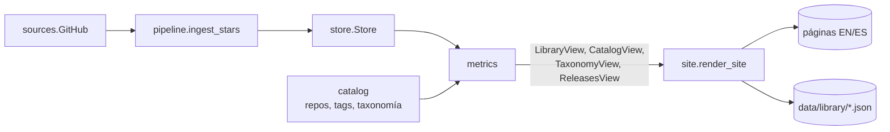

# Diseño — Etapa 4: base visual, librerías y comparador

> Fecha: 2026-11-09 · Estado: **aprobado por el usuario (2026-11-09), las 9 decisiones; implementado en local** · Rama
> `etapa-4-librerias-y-comparador`. Fuente funcional: `docs/prd.md` (historias 12–21, 50–53).
> Interfaces previas: `docs/design/etapa-3-vista-anual.md`. Vocabulario: módulo, interfaz, seam,
> adaptador, profundidad (skill `codebase-design`).

## Cambios respecto de lo propuesto

- **Categoría "Otros"** (pedido del usuario al aprobar): slug `other`, dentro de Utilidades, para lo que
  no entra con claridad en otra. Se movieron 7: `absl-py`, `aiofiles`, `arrow`, `h5py`, `networkx`,
  `pendulum` y `python-slugify`. Como cambian cuotas, `data/frozen/` se regeneró, sin subir la
  metodología porque el sitio aún no se publicó.
- `render_site` recibe un `BrowseView` además de sus argumentos, no un `SiteInputs`: alcanza con
  eso y los tests existentes no cambian de forma.
- `ingest_stars` no recibe `budget`: el presupuesto lo controla el adaptador, donde se cuentan las
  consultas.
- Hay 459 repos únicos con `repos.yaml` completo, no 438: el costo sube a unas 9.500 consultas.

## Objetivo

Primero la base visual: cabecera, navegación, portada y sistema de estilos, incluido el tramo del
mes en curso. Sobre esa base: fichas con series y sparklines, comparador, releases de Python,
estrellas de GitHub, páginas de dominio y categoría, y filtro por tags. Todo en local.

**Fuera de la Etapa 4:** auditoría de accesibilidad y pulido final, página de metodología, GitHub
Actions y Cloudflare Pages (Etapa 5).

## Resumen de decisiones

| # | Decisión | Recomendación |
|---|---|---|
| 1 | Dirección visual | **A, Estratos**: la portada es la cuota por dominio, año por año |
| 2 | Mes en curso | Cortar la línea en el último mes cerrado; el mes en curso va como franja y texto |
| 3 | Origen de `repo` | PyPI como borrador, ClickPy como pista, en `catalog/repos.yaml` revisado |
| 4 | Tags | Ampliar de 9 a 13 con reglas como borrador: de 85 a 176 librerías |
| 5 | Corrida de estrellas | Token personal, tres corridas locales de 4.000 consultas, unas 2,5 h en total |
| 6 | Medida en listados y comparador | Cuota de PyPI, no descargas absolutas |
| 7 | Comparador | Hasta 4 librerías, enlazable, con JSON por librería generado en el build |
| 8 | Filtro por tags | En el cliente sobre `/library/`, sin una página por tag |
| 9 | Tipografía | Fuentes del sistema; nombres de paquete en monoespaciada |

## Evidencia medida (2026-11-09, datos hasta 2026-11-08)

| Pregunta | Resultado |
|---|---|
| ¿Cuánto cae a la vista el mes en curso? | Noviembre (8 días) contra octubre completo: −73,5 % mediana en 500 paquetes (p10 −75,7 %, p90 −71,0 %). `fastapi`: 506 M → 140 M. |
| ¿Sirve proyectar el mes por su ritmo? | Error absoluto del ritmo contra el mes final (15.358 paquete-mes, 2024–jul. 2026): día 3 = 12,5 % mediana, 31 % p90; día 8 = 5,3 % y 16 %; día 15 = 3,3 % y 10,4 %. |
| ¿Hay URL de GitHub en PyPI? | 462 de 500 (`project_urls` + `home_page`). Quedan 38; 7 de ellos están en ClickPy. Hay 438 repos únicos. |
| ¿PyPI o ClickPy? | ClickPy cubre 414 de 500 y coincide con PyPI en 323 de 407. En las diferencias revisadas (25 de 84), ClickPy suele tener el dueño viejo (`tiangolo/fastapi`) o restos (`Tinche/aiofiles#history`). |
| ¿Son correctos los repos de PyPI? | Muestra aleatoria de 42: todos existen, 0 redirigen, 1 archivado (`boto/boto`). |
| Errores conocidos del borrador | `ansible` apunta a `ansible-community/ansible-build-data`. 8 paquetes tienen dos candidatos reales (`lightning`, `rdkit`, `rpds-py`, `typing-extensions`…). |
| Repos compartidos | 36 paquetes comparten 12 repos (`google-cloud-python` 8, `azure-sdk-for-python` 4, `langchain` 4…). |
| Costo del backfill | Muestra de 42: 581 semanas y 19,8 páginas de media → 8.687 consultas para 438 repos, más 438 de metadatos ≈ 9.100. Confirma las ~9.000 de S3. |
| Límites de GitHub (documentación vigente) | Sin token 60/h; token personal 5.000/h; `GITHUB_TOKEN` de Actions 1.000/h por repo; 900 puntos/min (un GET = 1). |
| Tags hoy | 9 tags, 85 de 500. Clasificadores en 484 paquetes, keywords en 205 (ruidosas: `python`, `data`, `web`). |
| ¿Las sparklines de descargas distinguen? | Top 100 sin Infraestructura base, 36 meses: correlación mediana entre pares **0,961** (78 % de los pares > 0,9). Con cuota de PyPI: **0,045** (7 % > 0,9). |
| Escala entre paquetes | Octubre de 2026: mínimo 11.596, mediana 78 M, máximo 2.672 M. |
| Peso de los datos | JSON de una serie: 3,0 KB (1,0 KB con gzip). Listado de 500 filas con sparkline: ~380 KB sin comprimir (estimado). |

**Límites de la evidencia.** La muestra de 42 prueba que el repo existe y cuál es su nombre
canónico, no que sea el repo correcto del paquete (el caso `ansible` pasaría). El peso del Parquet
de estrellas (~1 MB, ~254.000 filas) es una estimación por analogía con las descargas. La causa de
la caída del 2026-08-25 sigue sin explicar: la vista previa la rotula "discontinuidad", sin atribuirla.

## Decisión 1 — Dirección visual

**Vista previa con datos reales** (sin JavaScript ni tooltips; portada y ficha de cada dirección).
Se abre sin servidor, en `build/preview-etapa-4/` (ignorado por git):

| Dirección | Portada | Ficha | Capturas |
|---|---|---|---|
| **A · Estratos** | `a/index.html` (y `a/librerias.html`) | `a/ficha.html` | `shots/a-index.png`, `a-index-dark.png`, `a-index-390.png`, `a-librerias.png`, `a-ficha.png` |
| **B · Índice** | `b/index.html` | `b/ficha.html` | `shots/b-index.png`, `b-ficha.png` |
| **C · Anuario** | `c/index.html` | `c/ficha.html` | `shots/c-index.png`, `c-ficha.png` |

- **A · Estratos.** La portada es el dato: una columna por año con la cuota de cada dominio, y cada
  columna abre su año. Cada dominio tiene un color fijo en todo el sitio. Fondo claro azulado, modo
  oscuro seleccionado aparte.
- **B · Índice.** La portada es una tabla densa de paquetes con sparkline, y los años son un selector.
  Neutra, con un solo acento verde.
- **C · Anuario.** Una franja azul profundo con los años en números enormes y el año en curso
  destacado; debajo, frases con los hallazgos.

**Recomendación: A.** Es la única donde la portada responde la pregunta del producto ("cómo cambió
el ecosistema") y usa la cuota, la medida que el PRD eligió porque neutraliza la inflación por CI.
Le agrego lo mejor de B, los nombres de paquete en monoespaciada y la tabla densa en `/library/`.
C es la más llamativa, pero sus números enormes son navegación sin dato. B funciona como catálogo y
pierde la lectura por año.

**Evidencia de color (`validate_palette.js`, claro y oscuro):** el orden naranja, violeta, aqua,
amarillo, azul pasa todas las comprobaciones (CVD adyacente 9,1 claro y 8,4 oscuro). Un gris para
Infraestructura falló el piso de croma, y por eso es azul. En modo claro, aqua y amarillo quedan por
debajo de 3:1, lo que obliga a etiquetas o tabla: la leyenda y los valores siempre están visibles.
El dominio que cuenta la historia (Datos e IA) lleva el color cálido y va sobre la base, donde su
crecimiento se lee sin comparar alturas flotantes.

## Decisión 2 — Mes en curso

| Opción | Problema |
|---|---|
| Tramo punteado (hoy) | Es lo que se lee como caída: −73,5 % de mediana |
| Proyectar por ritmo | Con 3 días, error de 31 % en p90; además, publicar una cifra estimada contradice "los huecos no se interpolan" |
| Eje en descargas por día | Cambia la medida de toda la ficha para resolver un solo mes |
| **Cortar la línea** (recomendada) | Requiere explicar el mes en curso en otro lado |

**Recomendación:** la línea termina en el último mes cerrado. El mes en curso queda como una franja
tenue al final del eje, con el texto "nov. en curso: 140 M en 8 de 30 días" debajo. El dato parcial
sigue en la tabla y en el tooltip de la franja. Las discontinuidades se marcan con una línea vertical.

## Decisión 3 — De dónde sale `repo`

**Recomendación:** un script único, `docs/spikes/s8_repos_y_tags.py`, con el patrón de los spikes:

1. Toma `project_urls` y `home_page` de PyPI, con prioridad Source > Repository > Homepage, y
   descarta `.github`, `sponsors` y similares.
2. Usa ClickPy solo como pista para los 38 sin dato (cubre 7).
3. Escribe `catalog/repos.yaml`, con `owner/name` o `null` explícito ("revisado, sin GitHub").
4. Marca para tu revisión los 8 ambiguos, `ansible` y los 31 sin candidato.

**Por qué un archivo aparte de `libraries.yaml`:** estás por revisar ese archivo, y agregar 500
valores generados ensuciaría esa revisión. `Catalog.load` une ambos y exige que cada paquete tenga
entrada, igual que hoy exige categoría. Valida `owner/name` con una expresión estricta, porque ese
texto termina en una URL.

**Por qué un script y no un comando permanente:** entran pocos paquetes nuevos por año y se
agregan a mano; un adaptador de PyPI más no se paga.

Los renombres de repos se detectan solos: `ecopy stars` compara `full_name` con lo declarado y lo
informa. `repo` y los tags no invalidan `data/frozen/`: `year_view` no los lee (verificado en
`src/`), solo usa la categoría.

## Decisión 4 — Tags

Medido con reglas sobre clasificadores y prefijos:

| Tag | Librerías | Categorías | Origen |
|---|---|---|---|
| `typed` (nuevo) | 79 | 24 | `Typing :: Typed`, `types-*` |
| `async` | 23 (hoy 16) | 8 | `Framework :: AsyncIO/Trio/AnyIO`, prefijos |
| `django` (nuevo) | 7 | 3 | `Framework :: Django`, prefijo |
| `jupyter` (nuevo) | 7 | 1 | clasificadores, quitando 4 falsos positivos |
| `pytest` (nuevo) | 6 | 2 | `Framework :: Pytest`, prefijo |

**Recomendación:** ampliar a 13 tags (los 9 actuales + 4 nuevos). Pasa de 85 a **176 librerías**
(110 sin contar `typed`). Criterio: al menos 5 librerías y que no repita el nombre de una categoría.

- **Descartados por ese criterio:** `flask` (4), `pydantic` (4), `opentelemetry` (4), `langchain`
  (5, en una sola categoría) y `backport` (9, todos en Infraestructura base).
- **Las reglas son borrador, no verdad:** `jupyter` marcaba `rich`, `tqdm`, `progressbar2` y
  `scalene` por declarar `Framework :: IPython`. Ya los excluí y queda a tu revisión.
- **Las keywords quedan afuera:** 205 de 500 y con ruido.
- No busco cubrir las 500: los tags navegan, y la mayoría de Infraestructura base no necesita uno.

Los cambios van en `libraries.yaml` y tocan unas 100 líneas. **Conviene que revises el catálogo una
sola vez, después de este borrador.**

## Decisión 5 — Corrida real de estrellas

| Opción | Tiempo | Problema |
|---|---|---|
| `GITHUB_TOKEN` de Actions (S3) | ~10 días | No hay Actions hasta la Etapa 5 |
| Sin token | ~150 h | Inviable |
| **Token personal, local** (recomendada) | ~2,5 h | Lo tenés que crear y correr vos |

**Recomendación:**

1. Creás un token *fine-grained*, de solo lectura de repos públicos, sin permisos extra y con
   vencimiento corto (7 días).
2. En tu terminal, sin pegarlo en el chat: `read -rs GITHUB_TOKEN && export GITHUB_TOKEN`.
3. Corrés tres veces `uv run ecopy stars --budget 4000`. A 1 consulta/s son unos 67 min por corrida
   y 3.600/h, por debajo del límite de 5.000/h, así que no hace falta esperar entre corridas.

**Comportamiento:**

- Avanza repo por repo y solo guarda repos completos, y su suma debe cuadrar con `stargazers_count`
  (tolerancia de max(5, 0,1 %), porque pueden llegar estrellas durante la paginación).
- Se detiene si quedan menos de 100 consultas, ante 403/429 respeta `retry-after` y
  `x-ratelimit-reset`, y guarda lo completado incluso si se interrumpe.
- Se reanuda solo: un repo con filas de `backfill` ya no se repite.
- Después de un backfill, cada corrida consulta página 1 + metadatos: 2 consultas por repo, unas
  880 por día, dentro de los 1.000/h de Actions.
- Un repo se consulta una vez aunque lo compartan varios paquetes. La ficha lo aclara, y las
  estrellas no se usan para rankings.
- El token solo se lee del entorno y va en la cabecera. Nunca se imprime ni se persiste, y lo
  cubre un test.

**Comando aparte de `ingest`:** una falta de token no debe frenar las descargas. Además, sus
registros van a `data/runs/stars/`, porque `site_status` usa la última corrida de `data/runs/` y una
corrida de estrellas cambiaría la fecha de "Última actualización".

**Verificación:** con fixtures grabadas, más una prueba real sin token sobre uno o dos repos jóvenes
(la cuota sin token alcanza). La corrida completa la verificás vos, y yo reviso el resultado.

## Decisión 6 — Cuota de PyPI en listados y comparador

Las descargas de los últimos 36 meses están dominadas por la inflación general (correlación 0,961
entre paquetes): todas las sparklines dibujan la misma subida. Con la cuota, la correlación baja a
0,045 y se ven las trayectorias propias. El PRD da las métricas relativas por comparables a través del
salto de 2018; para la discontinuidad de agosto de 2026 no lo verifiqué.

**Recomendación:**

- **Sparklines:** cuota mensual de PyPI, 36 meses cerrados, cada una con su escala. Al lado, las
  descargas del último mes cerrado para dar la magnitud.
- **Listados:** sin columna de crecimiento, porque cualquier comparación interanual actual cruza la
  discontinuidad, y el PRD no la calcula.
- **Ficha:** descargas absolutas (historia 13) y un segundo gráfico de cuota. Nunca doble eje.
- **Comparador:** cuota por defecto, con opción de descargas.

## Decisión 7 — Comparador

- **URL:** `/{lang}/compare/?p=fastapi&p=django`, enlazable, actualizada con `history.replaceState`.
- **Hasta 4 librerías:** el límite de etiquetado directo de `dataviz`. El color sigue a la librería
  y no cambia al quitar otra.
- **Datos:** `/data/library/{slug}.json` por librería (meses, descargas, cuota), más un índice de
  nombres. Lo admite la CSP actual (`connect-src 'self'`).
- **Escala:** lineal, con opción logarítmica: la escala entre paquetes es de 230.000 a 1.
- **Sin formulario:** la CSP tiene `form-action 'none'`. Selector con `<input list>` y JavaScript.
- **Sin `innerHTML`** con datos, y validación contra el índice de nombres.
- **Accesibilidad básica:** tabla equivalente debajo y un `<noscript>` que explica el requisito.

## Decisión 8 — Filtro por tags

Filtro en el cliente sobre `/library/` con `data-tags` por fila; el tag queda en la URL (`?tag=async`).
Varios tags se combinan con AND. Sin JavaScript se ven las 500. Los tags de la ficha enlazan ahí.

No genera una página por tag: el PRD dice que los tags "solo navegan" y excluye métricas sobre tags.

## Decisión 9 — Tipografía

Fuentes del sistema para todo y monoespaciada del sistema para nombres de paquete, que son código.
Peso adicional: 0 KB y sin nuevo archivo de licencia. Si después querés una fuente propia, `font-src
'self'` la admite y es un cambio de tokens.

## Rutas

| Ruta | Contenido |
|---|---|
| `/{lang}/` | Portada |
| `/{lang}/year/{y}/` | Año (existe, se adapta a la base) |
| `/{lang}/library/` | Catálogo con sparklines y filtro por tags |
| `/{lang}/library/{slug}/` | Ficha |
| `/{lang}/domain/{d}/`, `/{lang}/category/{c}/` | Cuota por año y sus librerías |
| `/{lang}/compare/` | Comparador |
| `/{lang}/python/` | Releases y ciclo de vida |
| `/data/library/{slug}.json`, `/data/library/index.json` | Datos del comparador |

`ecopy serve` hoy anuncia `/en/library/`, que no existe: con esta etapa pasa a existir.

## Flujo



## Módulos e interfaces

### `catalog`

```python
@dataclass(frozen=True)
class Library:
    project: str
    category: str
    tags: tuple[str, ...]
    repo: str | None          # desde repos.yaml
    renamed_from: str | None

class Catalog:
    def libraries(self) -> tuple[Library, ...]: ...
    def domains(self) -> tuple[Domain, ...]: ...        # dominio → categorías, en orden
    def tags(self) -> tuple[str, ...]: ...              # vocabulario
```

**Seam y test:** YAML de ejemplo. Falta de entrada en `repos.yaml`, `owner/name` inválido y repo
declarado para un paquete inexistente se rechazan.

### `sources.GitHub` — adaptador

```python
class GitHub:
    def __init__(self, client: httpx.Client, *, token: str | None, sleep=time.sleep): ...
    def repo(self, name: str) -> RepoInfo: ...                  # full_name, stargazers_count
    def star_weeks(self, name: str, *, pages: int | None) -> tuple[StarWeek, ...]: ...
    @property
    def remaining(self) -> int | None: ...
```

Errores: `RateLimited(reset_at)` y `SourceError`. Solo lee `week` y `total`: nunca identidades.
**Seam y test:** `httpx.MockTransport` con respuestas grabadas: paginación, 404, 403 con `retry-after`, suma
que no cuadra, y que el token no aparezca en ningún error.

### `store`

Dos datasets nuevos: `star_weeks` (clave repo + semana) y `star_totals` (clave repo + día). Cambio
interno: `_Dataset` declara su columna de valor, hoy fija en `downloads`. Lecturas nuevas:
`star_weeks(repos)`, `star_totals(repos)` y `backfilled_repos()`.

**Una escritura por corrida**, no por repo: 438 repos × ~11 años serían unos 4.800 archivos.

### `pipeline.ingest_stars`

```python
def ingest_stars(repos, source: GitHub, store: Store, *, now: datetime, budget: int) -> StarsReport: ...
```

Prioriza repos sin backfill, después actualiza. Un repo que falla se informa y no detiene la corrida.

### `metrics` — funciones puras

```python
def library_view(project, series, *, as_of, totals=None, stars=None, library=None) -> LibraryView: ...
def catalog_view(libraries, views) -> CatalogView: ...
def taxonomy_view(years, catalog_view, catalog) -> TaxonomyView: ...
def releases_view(releases, *, as_of) -> ReleasesView: ...
```

`LibraryView` suma cuota mensual, categoría, dominio, tags, repo, renombres (en los dos sentidos) y
`StarsView | None`. Las estrellas acumuladas salen de sumar las semanas netas; la nota de metodología
aclara que la historia es neta y el artefacto de la semana de creación.

### `site`

`render.py` pasa a un paquete con tres módulos internos: `i18n.py` (textos), `charts.py` (opciones
de ECharts) y `svg.py` (sparklines, estratos y ciclo de vida de versiones). La interfaz sigue siendo
`render_site`, ahora con un `SiteInputs` en lugar de más argumentos.

`library.html` pasa a extender `_base.html` (hoy duplica la página entera). La cabecera y el cambio
de idioma se generan en un solo lugar, y `library.js` y `charts.js` se unifican.

**Seam y test:** se renderiza con vistas construidas a mano y se revisa el HTML. Los snapshots se
regeneran a propósito y el diff se revisa. Sigue vigente la CSP sin contenido inline: los SVG usan
atributos de presentación y clases, no `style`.

## Orden de implementación (TDD, de corrido)

1. **Base visual:** tokens, `_base`, cabecera, navegación, portada con estratos, mes en curso, y
   año y ficha sobre la base. `PRODUCT.md` y `DESIGN.md`, que pide `impeccable`.
2. **Catálogo:** `repos.yaml`, tags y validaciones.
3. **Listados:** sparklines, `/library/`, filtro por tags, dominio y categoría.
4. **Ficha ampliada:** cuota, categoría, tags, repo y renombres.
5. **Comparador.**
6. **Releases de Python.**
7. **Estrellas:** adaptador, store, pipeline, CLI y ficha con estado "sin datos".
8. **Cierre:** suite, ruff, Chrome headless (CSP con control positivo, 390 px, modo oscuro),
   mutaciones con verde previo sin mutar, handoff, comandos y mensajes de commit y PR.

## Lo que queda de tu lado

- Revisar `catalog/libraries.yaml` y `catalog/repos.yaml`.
- Crear el token y correr `ecopy stars`.
- Ejecutar los commits y el PR.
